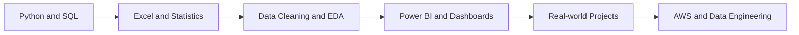
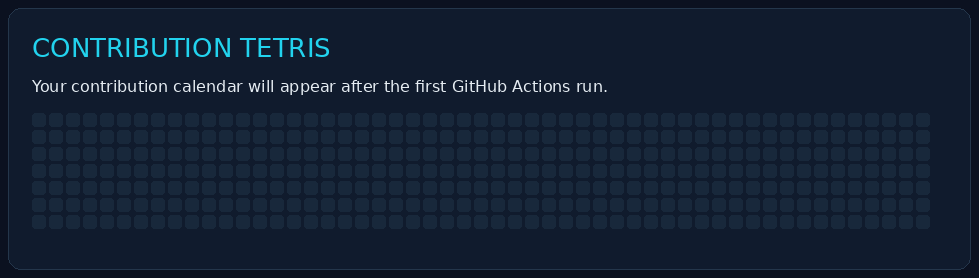

<!-- GitHub profile README | YASHWANTH-KURAPATI -->

  

  

  
Turning curiosity into code, data into insights, and ideas into useful solutions.

  
  
  
  
  

---

## About Me

I'm a B.Tech student at **MLR Institute of Technology, Hyderabad**, building practical skills in data analytics, data science and AI. I enjoy working with data, experimenting with new technologies and developing projects that solve real-world problems.

- **Career focus:** Data Analytics and Data Science
- **Currently learning:** SQL, data visualization, statistics and AWS data analytics
- **Exploring:** Generative AI, RAG, AI agents and data engineering
- **Interested in:** Internships, hands-on projects and collaborative learning

## Tech Stack

**Languages**

**Data & Analytics**

**AI & Emerging Technologies — Exploring**

**Development & Tools**

---

## Featured Projects

| Project | What it does | Status / Links |
| :--- | :--- | :--- |
| **MLRIT Student Management System** | Student management application with role-based dashboards and database integration. | [Source code](https://github.com/YASHWANTH-KURAPATI/mlrit-Student-Management-system) · [Live demo](https://mlrit-student-management-system-wu4a.onrender.com) |
| **2048 Game** | Interactive puzzle game with score tracking and a responsive web version. | Built |
| **LangChain Agent** | Experiments with AI agents and language-model workflows. | Learning project |
| **RAG Implementation** | Experiments with retrieval-augmented generation for contextual responses. | Learning project |
| **LangGraph Implementation** | Exploration of graph-based AI workflows. | Learning project |

[Browse all repositories →](https://github.com/YASHWANTH-KURAPATI?tab=repositories)

## My Data Analytics Roadmap

<b>Upcoming portfolio projects</b> (click to expand)

- Student Performance Analysis
- Sales Insights Dashboard
- Movie Dataset Explorer
- House Price Prediction

These are planned portfolio projects, not claims of completed work.

---

## GitHub Analytics

  
    
  
    
  

## Contribution Tetris

  
  
Falling blocks reveal my real GitHub contribution calendar. Updated daily with GitHub Actions.

<b>View static contribution calendar</b>

[View my native GitHub contribution calendar](https://github.com/YASHWANTH-KURAPATI)

---

## Resume

  
Explore my education, technical skills, projects and certifications.

  
  

---

## Let's Connect

I'm interested in connecting with developers, data professionals and fellow learners to share knowledge, collaborate and explore internship opportunities.

**Email:** [YASHWANTHKURAPATI22@GMAIL.COM](mailto:YASHWANTHKURAPATI22@GMAIL.COM)

**Learn → Build → Explain → Improve**

